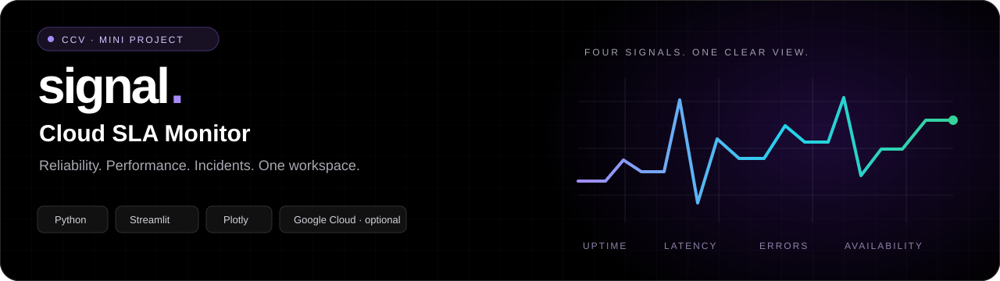
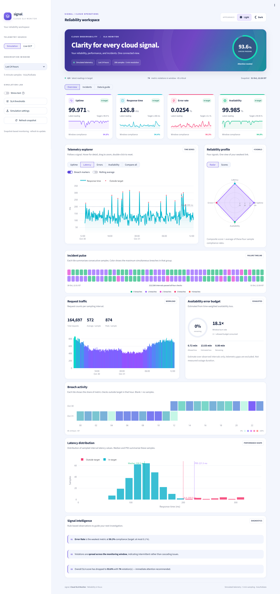
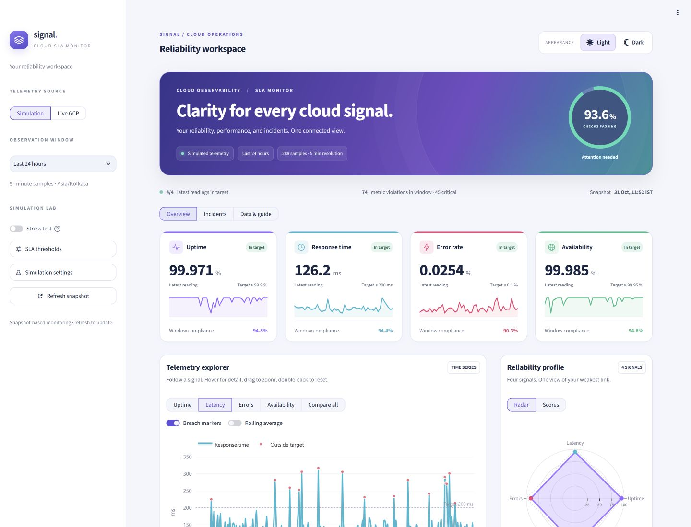
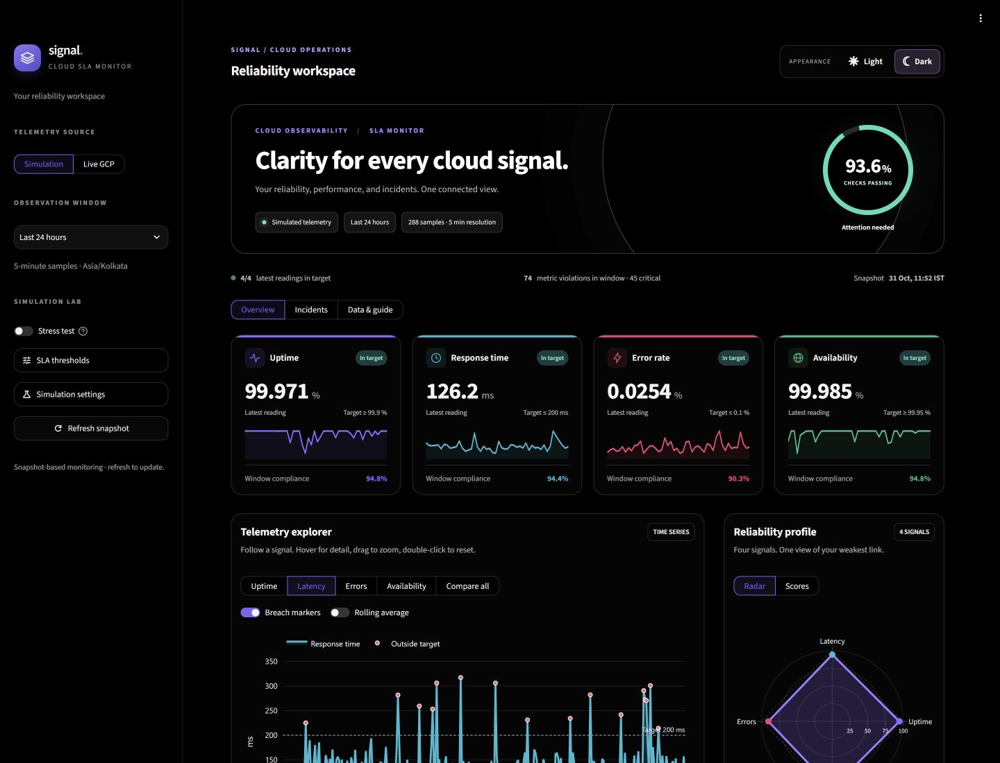
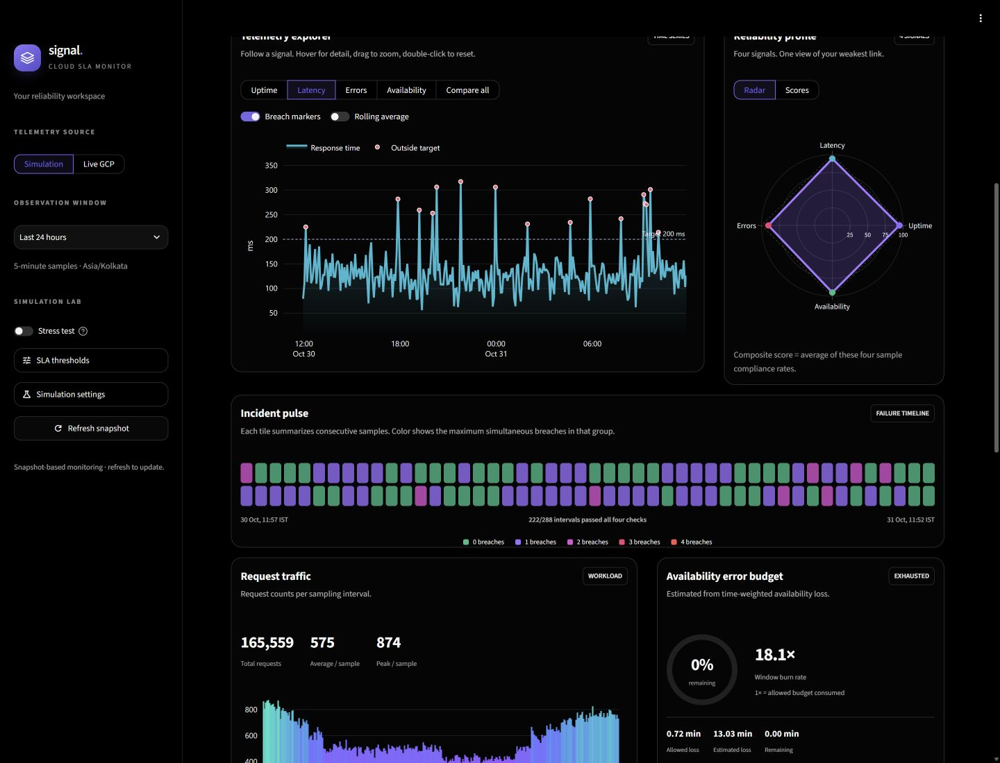
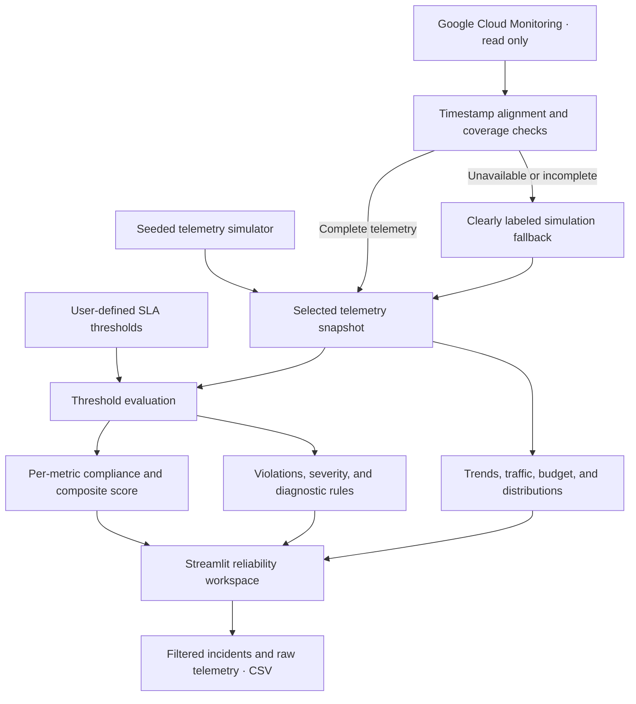

# Signal · Cloud SLA Monitor

<p align="center"><strong>Observe the signals. Investigate the breaches. Understand your SLA.</strong></p>

Signal turns cloud telemetry into a clear view of uptime, response time, error
rate, and availability. Explore trends, investigate threshold breaches, and
understand sample compliance through a Streamlit dashboard with vibrant visuals,
a light theme, and a pure black dark theme.

Run a reproducible simulation locally, or connect an optional read-only Google
Cloud Monitoring source.

Developed as a **mini project for U23CS702 — Cloud Computing Virtualization (CCV)**
at **Nehru Institute of Technology**.

[Full dashboard](#full-dashboard-screenshot) · [Quick start](#quick-start) ·
[Features](#features) · [Architecture](#system-architecture) ·
[Algorithm](#how-the-analysis-works) · [Project report](#mini-project-details)

| Four SLA metrics | Three workspaces | Two telemetry sources | Two native themes |
| :---: | :---: | :---: | :---: |
| Uptime · Latency · Errors · Availability | Overview · Incidents · Data & guide | Simulation · Optional Live GCP | Light · Pure black |

## Full dashboard screenshot

The complete dashboard, captured in the light theme: metric cards and sparklines,
interactive telemetry, reliability radar, incident pulse, request traffic, error
budget, breach heatmap, latency distribution, and diagnostic observations.

[](screenshot/screencapture-localhost-8501-2026-10-31-12_31_08.png)

**Click the screenshot to open the original 2880 × 6094 image.** The capture uses
simulated telemetry; the displayed values reflect its snapshot and settings.

### Light & pure black themes

| Light theme | Pure black dark theme |
| --- | --- |
|  |  |

The appearance controls sit above the dashboard. Dark mode uses a **#000000**
page and sidebar with neutral black cards; light mode uses white cards and a
soft background. Theme switching preserves the current snapshot and controls.

## Quick start

**Requirements:** Python 3.11+ recommended; Streamlit 1.66+ required.
No Google Cloud account is needed for simulation.

From the project folder, run these commands in PowerShell:

```powershell
git clone https://github.com/balamuruganpg/cloud-sla-monitoring-system-ccv-mini-project.git
cd cloud-sla-monitoring-system-ccv-mini-project
python -m venv .venv
.\.venv\Scripts\python.exe -m pip install -r requirements.txt
.\.venv\Scripts\python.exe -m streamlit run app.py
```

Open [http://localhost:8501](http://localhost:8501). If you already have the
project, start from its folder and skip the clone commands. If `.venv` already
exists, skip its creation. Launch with its Python executable to
use the installed dependencies instead of an older global Streamlit version.

### Try the dashboard

1. Keep **Simulation** selected and choose an observation window.
2. Explore a metric, or select **Compare all** to view four separate metric plots.
3. Enable **Stress test** to demonstrate more frequent and severe anomalies.
4. Adjust **SLA thresholds** and see how the same telemetry scores against them.
5. Open **Incidents** to filter breaches and export the matching records as CSV.

Use the visible **Light / Dark** controls above the dashboard to switch
appearance while preserving your snapshot and settings. Use **Refresh snapshot**
to update the observation window; collection does not run continuously in the
background.

## Features

### A connected reliability workspace

**Overview** brings the latest service readings and historical compliance
together. **Incidents** turns failed checks into searchable, exportable records.
**Data & guide** exposes the source samples and explains the calculations for
demonstrations and review.

### Beyond a collection of charts

| Area | What you can explore |
| --- | --- |
| **Metric cards** | Latest readings, target status, window compliance, and colored sparklines for four SLA metrics. |
| **Telemetry explorer** | Interactive time series with hover details, zoom, breach markers, rolling averages, and a four-metric comparison view. |
| **Reliability profile** | Switch between a radar chart and compliance scores to identify the weakest signal. |
| **Incident pulse** | A colored timeline showing the maximum simultaneous breaches within each group of samples; hover or focus for details. |
| **Traffic & budget** | Request counts per sampling interval and an estimated availability error budget with burn rate. |
| **Breach activity** | A date/hour heatmap revealing when metric checks failed. |
| **Latency distribution** | In-target and outside-target samples with median, P95, and SLA boundary markers. |
| **Incident investigation** | Metric, severity, and text filters; filtered CSV export; and a metric scorecard. |
| **Data & guide** | Raw telemetry, CSV download, methodology, and a five-step presentation walkthrough. |
| **Appearance** | Light and pure black dark themes, responsive cards, and motion effects that respect reduced-motion preferences. |

The sidebar offers 24-hour, seven-day, and 30-day windows, plus custom dates
covering up to 60 calendar days. Sampling resolution adapts to the window.
Timestamps in the dashboard and exports use **Asia/Kolkata (IST)**.

### Visual analytics in action



Hover for exact readings, drag to zoom into a time range, or compare four
metrics in separate plots with their own units. The radar uses a 0–100 compliance
scale; the incident pulse makes groups of simultaneous breaches easy to spot.

## System architecture



Source adapters provide the samples, the analyzer evaluates the targets, and
the dashboard presents the results. Changing a threshold re-evaluates the same
snapshot so comparisons remain meaningful.

## How the analysis works

The core algorithm is **threshold-based SLA evaluation**. Each sampled reading
is compared with its configured target using an inclusive comparison:

| Metric | Default target | A sample passes when |
| --- | --- | --- |
| Uptime | 99.9% | Reading ≥ target |
| Response time | 200 ms | Reading ≤ target |
| Error rate | 0.1% | Reading ≤ target |
| Availability | 99.95% | Reading ≥ target |

```text
Metric compliance (%) = passing samples / total samples × 100
Composite score (%)  = mean of the four metric compliance percentages
Violation deviation  = absolute difference between reading and target
```

**Example:** if 285 of 288 uptime samples meet the target, uptime compliance is
**98.96%**. If all four compliance scores are 98.96%, 100%, 97.22%, and 100%,
the composite is **99.05%**. This measures passing checks across the selected
window, separately from the latest reading.

Each failing metric reading becomes a violation record. Records are sorted by
timestamp and assigned a severity from their absolute deviation:
**Warning** below 0.05, **Moderate** from 0.05 to below 0.5, and **Critical** at
0.5 or above. These buckets use each metric's own units, so compare severity
within a metric.

Diagnostic observations use rules such as lowest compliance, business-hour
concentration, and gaps between violations. They guide investigation; they do
not establish root causes or use a trained machine-learning model.

### Interpreting the visuals

- **Latest status and window compliance answer different questions.** A latest
  reading can pass even when earlier samples breached the target.
- **The composite score is sample compliance**, not contractual uptime.
- **The availability error budget estimates loss** from availability percentages
  over observed intervals. Telemetry gaps are excluded; this is not measured
  outage duration.
- **Heatmap cells show the share of failed metric checks** in each date/hour.
  Blank cells mean no samples.
- **Latency median and P95 describe sampled interval values**, not individual
  request latencies. Traffic bars show counts per interval, not requests/minute.
- **Threshold changes reuse the same telemetry.** A fixed simulation seed
  reproduces the scenario; refreshing advances the observation window.

## Google Cloud setup (optional)

1. Enable `monitoring.googleapis.com` in your Google Cloud project.
2. Configure Application Default Credentials or set
   `GOOGLE_APPLICATION_CREDENTIALS` to your credential file path.
3. Grant the credential's account the `roles/monitoring.viewer` role.
4. Enter the project ID in the dashboard, or set `GCP_PROJECT_ID` or
   `GOOGLE_CLOUD_PROJECT` before launch.
5. Select **Live GCP** in the sidebar.

The adapter reads uptime checks and Cloud Run request-count/latency metrics.
If Cloud Run request data is absent, it tries HTTPS load-balancer metrics. It
computes error rate from HTTP 5xx request counts, weights latency distribution
means by sample counts, and aligns observations by timestamp. Availability
shares the uptime-check observations in this integration.

Missing credentials, permissions, metric streams, or aligned coverage trigger a
clearly labeled **simulation fallback**. Missing data is never replaced with
invented healthy readings. Authenticated ingestion requires your own cloud
project and is not covered by local UI verification.

See the [Google Cloud Monitoring metric catalog](https://docs.cloud.google.com/monitoring/api/metrics_gcp)
for metric definitions.

## Mini project details

**Cloud Computing Virtualization · U23CS702 · Nehru Institute of Technology**

| Detail | Information |
| --- | --- |
| Project | Signal — Cloud SLA Monitoring System |
| Student | BALAMURUGAN P G |
| Register number | 721023104019 |
| Institution | Nehru Institute of Technology |
| Course | U23CS702 — Cloud Computing Virtualization |
| Semester / class | VII Semester / 4 CSE A |
| Course instructor | Dr S Pathur Nisha |

### Report & outputs

| Artifact | Open |
| --- | --- |
| Final project report | [PDF](output/report/CCV_Mini_Project_Report_BALAMURUGAN_P_G.pdf) |
| Editable project report | [Word document](output/report/CCV_Mini_Project_Report_BALAMURUGAN_P_G.docx) |
| Complete dashboard output | [Full-resolution screenshot](screenshot/screencapture-localhost-8501-2026-10-31-12_31_08.png) |

The report covers the introduction, literature survey, proposed system,
conclusion, references, and dashboard output screenshots.

## Project structure

| Path | Purpose |
| --- | --- |
| [`app.py`](app.py) | Dashboard views, controls, session state, and exports |
| [`dashboard_ui.py`](dashboard_ui.py) | Metric cards, SVG sparklines, and Plotly charts |
| [`dashboard.css`](dashboard.css) | Visual styling, responsive layouts, and effects |
| [`dashboard_theme.py`](dashboard_theme.py) | Theme switching and restoration of controls |
| [`dashboard_data.py`](dashboard_data.py) | Date validation, error budget, heatmap, and incident filters |
| [`sla_simulator.py`](sla_simulator.py) | Reproducible synthetic telemetry and adaptive sampling |
| [`sla_analyzer.py`](sla_analyzer.py) | Compliance calculations, violation records, and diagnostic rules |
| [`gcp_metrics.py`](gcp_metrics.py) | Read-only Google Cloud ingestion and explicit fallback |
| [`.streamlit/config.toml`](.streamlit/config.toml) | Native light and dark theme configuration |
| [`tests/`](tests/) | Calculation, ingestion, theme, and Streamlit interaction checks |
| [`screenshot/`](screenshot/) | Full dashboard capture |
| [`artifacts/`](artifacts/) | Dashboard previews and other local artifacts |
| [`assets/`](assets/) | Repository presentation artwork |

The stack uses **Python, Streamlit, pandas, NumPy, Plotly, and Google Cloud
Monitoring**. Dependencies are listed in [`requirements.txt`](requirements.txt).
[`REPORT.md`](REPORT.md) documents the earlier exhibition version.

## Verification

Run the automated checks from the project folder:

```powershell
.\.venv\Scripts\python.exe -m unittest discover -s tests -v
.\.venv\Scripts\python.exe -m py_compile app.py dashboard_ui.py dashboard_theme.py dashboard_data.py gcp_metrics.py sla_simulator.py sla_analyzer.py
```
